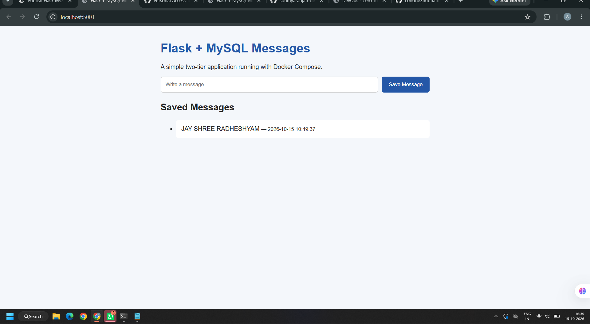

# Flask + MySQL with Docker Compose

A two-tier web application built with Flask and MySQL, containerized using Docker Compose.

## Architecture

Browser → Flask Application → MySQL Database → Persistent Volume

## Tech Stack

- Python and Flask
- MySQL 8.4
- PyMySQL and Gunicorn
- Docker and Docker Compose

## Features

- Add and display messages.
- Store messages in MySQL.
- Run Flask and MySQL in separate containers.
- Use a Docker network and health checks.
- Persist database data using a named volume.
- Keep credentials in environment variables.
- Run Flask as a non-root user.

## Setup

1. Clone this repository:

       git clone https://github.com/soumyaranjan-dev57/flask-mysql-docker-compose.git
       cd flask-mysql-docker-compose

2. Create your local environment file:

       cp .env.example .env
       vim .env

3. Set strong, unique database passwords in `.env`.

4. Validate and start:

       docker compose config
       docker compose up -d --build

5. Check containers:

       docker compose ps

6. Open http://localhost:5001 and submit a message.

## Useful Commands

    docker compose ps
    docker compose logs --tail=50 flask-app
    docker compose logs --tail=50 mysql
    docker compose restart flask-app
    docker compose down

`docker compose down` retains the named database volume. `docker compose down -v` deletes it and its stored data.

## Security

Never commit `.env` or real credentials. The `.env` file is excluded through `.gitignore` and `.dockerignore`.

## Learning Outcomes

- Docker image creation and container management.
- Flask and MySQL connectivity.
- Docker Compose networking and health checks.
- Environment variables and persistent volumes.
- Troubleshooting multi-container applications.

## Attribution

An independent learning implementation of a Flask + MySQL two-tier application.

## License

No license has been added to this repository yet.

## Application Screenshot

